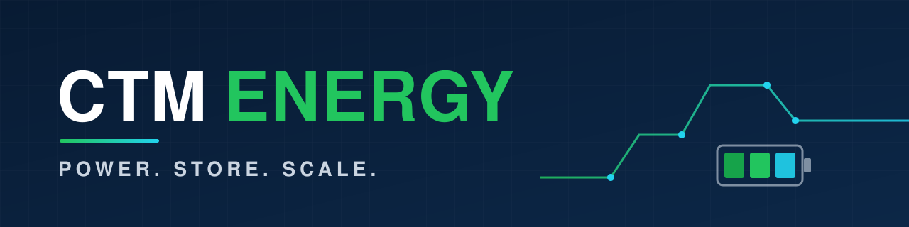

  

  
  
  

<h3 align="center">Modern energy infrastructure, battery storage, renewable integration and intelligent power systems.</h3>

---

## ⚡ Who we are

**CTM Energy** is an emerging Australian energy business with one goal: delivering **clean, affordable and reliable energy**.

We work where software meets the grid, building the platforms, integrations and controls that link customers, solar generation and battery storage to the National Electricity Market (NEM). We put engineering and infrastructure first and renewable energy second: if it isn't reliable, it isn't clean energy.

## 🔋 What we build

| Area | What lives here |
| --- | --- |
| **Energy Platform** | Customer, billing and market-data integrations for transparent, wholesale-linked retail energy |
| **Storage & Generation** | Monitoring and control for solar and battery energy storage systems (BESS) |
| **Intelligent Power** | Device-level power control, telemetry and automation for sites and equipment |
| **Market & Data** | Pricing, analytics and reporting tooling built on NEM market data |
| **Mining & Industrial** | Energy and operational tooling for mining and heavy-industry sites |

## 🗂️ Repositories

> 🚧 **Moving in.** We're migrating our energy and mining projects into this organisation. Repositories will appear below as they arrive.

| Repository | Description | Status |
| --- | --- | --- |
| _coming soon_ | | 🟡 Migrating |

## 🧭 How we work

- **Technical.** We design it properly, document it and test it.
- **Reliable.** Energy systems run 24/7, and our code has to as well.
- **Scalable.** We build for one site today and a whole portfolio tomorrow.
- **Secure by default.** No secrets in repos. We use least-privilege access and review every change.
- **Forward-thinking.** EV tariffs, community solar, virtual power plants: we're building toward a more decentralised grid.

## 🤝 Contributing

Most of our repositories are private. If you're a team member or partner:

1. Request access through your CTM Energy contact.
2. Branch from `main` and open a pull request. Direct pushes to `main` are blocked.
3. Follow each repository's `README` and `CONTRIBUTING` guidance.

## 📬 Contact

[CTMEnergy.au](https://ctmenergy.au/) . [Contact Us](mailto:info@ctmenergy.au)

  <b>CTM ENERGY</b> · POWER. STORE. SCALE.

